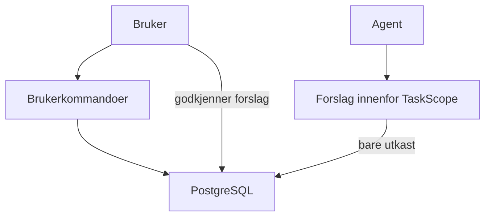

> **Historisk grunnlag, ikke oppdatert.** Opprinnelig dokument fra 9. november 2026 (filnavn: «Paintrest – databaseskjema og arkitektur.md»), lagt inn uendret 24. november 2026. Løsningen har utviklet seg siden. Koden og brukerens beslutninger i [docs/beslutninger/](../beslutninger/) går foran. Hva som fortsatt ser ut til å gjelde, står i [VURDERING.md](VURDERING.md).

# Paintrest – databaseskjema og arkitektur

Forslag · 9. november 2026  
Bygger på godkjent logisk datamodell v3, med ett nytt grunnkrav: appen skal kunne brukes fullt ut uten AI. Dette er ikke implementert. Ingen migrasjoner kjøres ut fra dette dokumentet.

Skjemaet er skrevet for PostgreSQL, fordi modellen krever fremmednøkler, transaksjoner og delvise unikhetskrav. At motoren er PostgreSQL, er en teknisk anbefaling, ikke et produktkrav. Hvor filer og krypteringsnøkkel fysisk ligger, er fortsatt et teknisk valg.

# 1. Grunnkrav: full manuell kontroll

Paintrest skal kunne brukes fullt ut uten AI. Brukeren har full kontroll over egne data. Agentens `TaskScope` og typede operasjoner gjelder bare agenten.

Brukeren oppretter, endrer, sletter, kobler og løsner eget innhold med vanlige kommandoer: `create`, `update`, `delete`, `attach`, `detach` og `restore`. Kommandoene skriver ikke `research_proposal`, og de krever ikke researchoppgave eller en egen godkjenningsrunde.

Det gjelder spill, prosjekter, utvidelser og miniatyrer. Det gjelder teknikker, oppskrifter, maleplaner og steg. Det gjelder malingsprodukter, inventar og fargekombinasjoner. Det gjelder tekster, bilder, kilder, referanser og relasjonene mellom dem.

Sentrale objekter kan opprettes ufullstendige og fylles senere. Opprettelse bruker standardverdier og automatisk navn, ikke et obligatorisk skjema. «Nytt prosjekt» oppretter spillet og prosjektet med en gang. Uten navn blir navnet «Nytt spill 1», deretter «Nytt spill 2». BoardGameGeek-oppslag er valgfritt og kan gjøres senere. «Ny miniatyr» krever ikke bilde, kategori eller maleplan. «Ny teknikk» og «ny oppskrift» opprettes tomme, med automatisk navn. «Ny maling» kan lagres selv om produsent og serie er ukjent, og selv om produktet ikke finnes i en katalog fra før.

Historiske maleplaner og oppskrifter som faktisk er brukt, skal fortsatt kunne rekonstrueres. Det løses med versjoner som ikke endres etter at de er skrevet, med skjuling fremfor sperret sletting, og med gjenoppretting. Det løses ikke ved å ta fra brukeren redigering eller sletting.

# 2. To skrivestier

Brukerkommandoer skriver kanoniske rader direkte. En redigering av gjeldende oppskrift eller maleplan oppretter neste versjon i samme kommando og flytter pekeren. Brukeren starter ikke research for det.

Agenten skriver bare egne utkast, innenfor omfanget i avsnitt 3. Et forslag blir kanonisk først når brukeren godtar det. Den stien er valgfri. Ingenting i appen krever at den er brukt.

`change_record` skrives i begge stiene. Manuelle endringer har `initiated_by = user` og tom `proposal_id`.

# 3. Bindende regel for agentens TaskScope

Et godkjent arbeidsområde skal kunne inneholde mange nye objekter og mange resultattyper samtidig. Det gir ikke agenten skrivetilgang til eksisterende objekter utenfor området.

For et nytt spill kan samme oppgave foreslå spillidentitet, mange figurer, palettoppføringer, metoder, referanseutvalg, mange maleplaner og nye oppskrifter og teknikker. Eksisterende prosjekter, oppskrifter og teknikker kan leses. Agenten kan ikke endre dem, med mindre brukeren har åpnet ett bestemt objekt som revisjonsmål.

Dette begrenser ikke brukeren. Brukeren kan redigere de samme objektene direkte, også mens en oppgave er åpen. Agenten kan fortsette å lese dem. Den kan ikke skrive over brukerens rader uten et nytt, godtatt forslag, og bare innenfor omfanget.

# 4. Kjøretid

Desktop-research og malevisning på iPad er klienter. De kaller applikasjonen. De har ikke databasetilkobling, og de ser ikke API-nøkkelen.

Applikasjonslaget er eneste skrivesti mot databasen. Brukerkommandoer og agentkommandoer er to sett. Agentens verktøy avledes av `task_scope` og `task_result_type`. Et verktøy som er feil eksponert, stoppes av den samme sjekken i kommandoen. Brukerkommandoene finnes ikke i agentens verktøysett.

BoardGameGeek brukes bare når brukeren ber om oppslag, eller når en researchoppgave gjør det innenfor omfanget. Et spill som allerede er opprettet, leses lokalt. Leverandørkallet er det eneste stedet som leser `secret_ciphertext`.

# 5. Moduler og hvem som skriver

Hver modul eier sine tabeller. Andre moduler kaller funksjoner, ikke fri oppdatering.

- **Hemmeligheter.** Leser og skriver `ai_credential`. Ingen annen modul, og ingen agentkommando, får kolonnen med hemmeligheten.
- **Katalog.** Brukeren oppretter, endrer og sletter produkter og inventar direkte. Import er en valgfri brukerkommando.
- **Prosjekt.** Brukeren oppretter og redigerer spill, utvidelser, prosjekt, figurer, palett og metoder direkte.
- **Kunnskap.** Brukeren oppretter og redigerer teknikker og oppskrifter direkte. Redigering skriver en ny versjon.
- **Kilder.** Brukeren laster opp, bytter, ordner, kobler og fjerner bilder og referanser direkte.
- **Plan.** Brukeren oppretter og redigerer maleplaner direkte. Avvik og fremdrift er brukerkommandoer i malevisningen.
- **Research.** Agenten skriver bare utkast her. Brukeren kan godta eller avvise dem. Ingen manuell redigering går denne veien.
- **Historikk.** `change_record` skrives i samme transaksjon som endringen.

Agenten har ingen kommando for brukerens `create`, `update`, `delete`, `attach`, `detach` eller `restore`, og ingen for godkjenning, inventar, fremdrift eller nøkkel.

# 6. Skjema

Identifikatorer er `uuid`. Tidsstempel er `timestamptz`. Oppregninger er `text` med `check`. Versjonsinnhold oppdateres ikke etter insert. Ny redigering setter inn neste versjon og flytter pekeren. Den forrige versjonen får status `superseded` og beholdes.

Lister i appen utelater rader med `deleted_at`. Gjenoppretting nuller `deleted_at`.

`workspace` har `id`, `display_name` og `created_at`. Personlige rader bærer `workspace_id`.

## Nøkkel

`ai_credential`: `id`, `workspace_id` unik, `provider`, `label`, `secret_ciphertext`, `default_model`, `created_at`.

Ingen innholdstabell har fremmednøkkel hit. Kolonnen inngår ikke i views som research eller malevisning leser. Forslag og `change_record` lagrer `provider` og `model_id`, aldri hemmeligheten.

## Filer

`stored_file`: `id`, `workspace_id`, `purpose` (`cover`, `source_asset`, `import`), `storage_key`, `media_type`, `byte_size`, `created_at`, `deleted_at`.

Importfiler kan slettes. En kildefil kan slettes når brukeren fjerner bildet. Historisk planrekonstruksjon bruker versjonens tekst og produkter, og er ikke avhengig av at filen ligger igjen.

## Maling og import

`paint_product`: `id`, `workspace_id`, `manufacturer`, `range_name`, `name`, `product_kind`, `coverage`, `finish`, `identity_status` (`unconfirmed`, `confirmed`), `created_at`, `deleted_at`.

`manufacturer` og `range_name` kan være null. `name` settes av brukeren, eller til «Ny maling 1» og videre. `product_kind` har standard `other`. `identity_status` har standard `unconfirmed`. Dekkevne og finish kan være null.

Unikhet på produsent, serie og navn gjelder bare der alle tre er fylt ut og `identity_status = confirmed`. Ubekreftede produkter kolliderer ikke med hverandre, og matching mot katalogen er ikke et vilkår for å lagre.

`paint_product_alias`: `product_id`, `alias`.

`inventory_entry`: primærnøkkel `(workspace_id, product_id)`, `ownership` (`owns`, `not_owned`, `unknown`), `ownership_source` (`manual`, `import`, `purchase`), `updated_at`. Opprettelse av en maling kan i samme kommando sette `owns`.

`shopping_need`: `id`, `workspace_id`, `product_id` unik per arbeidsrom, `priority` (`necessary`, `recommended`, `wishlist`), `note`. `shopping_need_project` kobler behovet til prosjekter.

`inventory_import`: `id`, `workspace_id`, `origin` (`list`, `images`, `mixed`), `status` (`open`, `closed`), `created_at`. Import er valgfri.

`import_image`: `id`, `import_id`, `file_id`, `deleted_at`. Dette er ikke en kilde.

`inventory_import_line`: `id`, `import_id`, `image_id` som kan bli null, `position`, `raw_name`, `proposed_manufacturer`, `proposed_range`, `match_state` (`matched`, `partial`, `unidentified`), `matched_product_id`, `decision` (`pending`, `accepted`, `rejected`), `accept_action` (`link_existing`, `create_product`).

Godtakelse av linjer er en brukerkommando. Den kan opprette et ubekreftet produkt når brukeren velger det, også om produsent eller serie mangler. Deretter kan `import_image` slettes. Linjene beholder navn og produktpeker.

## Spill og prosjekt

`game`: `id`, `workspace_id`, `origin` (`manual`, `bgg`), `bgg_thing_id`, `primary_name`, `year_published`, `publishers text[]`, `cover_file_id`, `created_at`, `deleted_at`.

`origin` starter som `manual`. `bgg_thing_id`, år, utgivere og omslag kan være null. `primary_name` får «Nytt spill 1» når brukeren ikke oppgir navn. Unik på `(workspace_id, bgg_thing_id)` der thing-id ikke er null, slik at samme BGG-spill ikke lagres dobbelt den dagen det kobles.

`expansion`: `id`, `game_id`, `origin`, `bgg_thing_id`, `name`, `year_published`, `deleted_at`. Navn kan være «Ny utvidelse 1». Unik på `(game_id, bgg_thing_id)` der thing-id ikke er null. Ingen kolonne for om utvidelsen er med.

`project`: `id`, `workspace_id`, `game_id`, `content_revision` heltall som starter på 0, `created_at`, `deleted_at`. «Nytt prosjekt» skriver `game` og `project` i én transaksjon. Revisjonen øker når palett eller metoder endres.

`project_expansion`: primærnøkkel `(project_id, expansion_id)`. Utvidelsen må høre til prosjektets spill. Brukeren kobler og løsner raden direkte.

`miniature_subject`: `id`, `project_id`, `expansion_id`, `name`, `grouping` (`single`, `group`), `physical_count`, `category_label`, `official_asset_id`, `plan_state` (`none`, `draft`, `approved`), `in_progress`, `finished_count`, `count_basis` og `grouping_basis` (`documented`, `inferred`, eller null), `uncertainty jsonb`, `current_plan_version_id`, `deleted_at`.

Standard er navn «Ny miniatyr 1», `grouping = single`, `physical_count = 1`, `plan_state = none`, `in_progress = false` og `finished_count = 0`. Bilde, kategori, utvidelse og maleplan kan være null. `finished_count` kan ikke overstige `physical_count`.

`palette_entry`: `id`, `project_id`, `product_id`, `role_label`, `note`, `scope_kind` (`project`, `expansion`, `category`, `subjects`), `expansion_id`, `category_label`, `deleted_at`. `palette_entry_subject` brukes når omfanget er `subjects`. Uten valgt omfang gjelder oppføringen prosjektet. Rolle og merknad kan være tomme.

`project_method`: `id`, `project_id`, `technique_version_id`, `note`, samme omfangskolonner, `deleted_at`. `project_method_subject` når omfanget er figurer.

## Maleplan

`paint_plan_version`: `id`, `subject_id`, `version_number`, `state` (`approved`, `superseded`), `origin` (`user`, `proposal`), `supersedes_id`, `created_at`. Unik på `(subject_id, version_number)`. En tom plan er gyldig: versjonen kan opprettes uten elementer.

`plan_element`: `id`, `plan_version_id`, `kind` (`operation`, `part`), `position`, `name`. Navn kan være «Ny del 1».

`plan_step`: `id`, `element_id`, `position`, `instruction`, `technique_version_id`, `recipe_version_id`. Instruks kan være tom.

`step_material`: `id`, `step_id`, `position`, `product_id`, `role`, `role_label`. Produktet kan ha `identity_status = unconfirmed`. Rolle er `base`, `shade`, `layer`, `highlight`, `wash`, `glaze`, `mix` eller `other`.

`mix_group`: `id`, `step_id`, `label`. `mix_component`: `mix_group_id`, `position`, `product_id`, `parts`. Ett steg har enten materialer eller én blanding, eller ingen av delene ennå.

`plan_step_asset`: `step_id`, `source_asset_id`.

`local_deviation`: `id`, `plan_version_id`, `element_id`, `step_id`, `kind`, `payload jsonb`, `created_at`, `sealed_at`. Etter `sealed_at` avvises oppdatering av `payload`. Nye avvik er brukerkommandoer.

`part_progress`: primærnøkkel `(subject_id, element_id)`, `done`, `last_opened_at`.

`group_progress`: `id`, `subject_id`, `plan_version_id`, `element_id`, `count`. Subjectet må ha `grouping = group`, og `count` kan ikke overstige `physical_count`.

`paint_completion`: `id`, `subject_id`, `plan_version_id`, `deviation_snapshot jsonb`, `quantity`, `finished_count_after`, `created_at`. Samme transaksjon setter `sealed_at` på avvikene som er kopiert inn. Versjonen ferdigstillingen peker på, slettes ikke.

Når brukeren redigerer gjeldende plan, kopierer kommandoen strukturen til neste `version_number`, legger inn endringen, setter den forrige til `superseded` og flytter `current_plan_version_id`. Den forrige raden endres ikke. `origin` er `user`. Ingen `research_proposal` skrives.

## Kunnskap

`technique`: `id`, `workspace_id`, `current_version_id`, `deleted_at`.

`technique_version`: `id`, `technique_id`, `version_number`, `state`, `title`, `summary`, `materials_note`, `evidence`, `decision`, `experience`, `created_at`. Unik på `(technique_id, version_number)`. `technique_step`, `technique_variation` og `technique_pitfall` kan mangle. Tittel blir «Ny teknikk 1» når brukeren ikke oppgir navn.

`recipe`: `id`, `workspace_id`, `based_on_recipe_version_id`, `current_version_id`, `deleted_at`. Remiks er en ny rad, med peker til grunnversjonen. Pekeren endrer ikke den versjonen. Brukeren kan også opprette en tom oppskrift uten grunnlag.

`recipe_version`: `id`, `recipe_id`, `version_number`, `state`, `title`, `expression`, `evidence`, `decision`, `experience`, `created_at`. Unik på `(recipe_id, version_number)`. Tittel blir «Ny oppskrift 1» når navn mangler. Roller og steg kan mangle.

`recipe_role`: `id`, `recipe_version_id`, `position`, `role`, `role_label`, `product_id`. Blanding bruker `recipe_mix_group` og `recipe_mix_component`. `recipe_step` finnes når oppskriften har sekvens. En manuell redigering kopierer gjeldende versjon til neste nummer på samme måte som maleplanen.

`evidence` er `documented`, `synthesized` eller `unresolved`, med standard `unresolved` for manuell opprettelse. `decision` er `approved` når brukeren selv opprettet eller redigerte versjonen. `experience` er `untried`, `used`, `succeeded` eller `needs_adjustment`, med standard `untried`.

## Kilder

`source`: `id`, `workspace_id`, `kind`, `title`, `creator`, `url`, `locator`, `analysis_state` (`stored`, `extracted`), `retention` (`draft`, `kept`), `created_by_task_id`, `created_at`, `deleted_at`.

Manuell opplasting skriver `retention = kept` med en gang. Tittel kan være filnavnet eller «Nytt bilde 1». Url, skaper og stedfesting kan være null. `analysis_state` starter som `stored`.

`source_asset`: `id`, `source_id`, `position`, `locator`, `caption`, `file_id`, `deleted_at`. Brukeren kan legge til, bytte fil, endre rekkefølge og slette elementet.

`source_layer`: `id`, `source_id`, `layer` (`original`, `translation`, `extract`), `language`, `body`, `deleted_at`. `source_layer_asset` kobler laget til bildene det hører sammen med. Tekstlag er valgfrie.

`source_link`: `id`, `source_id`, `target_type`, `target_id`, `use` (`evidence`, `visual_reference`, `method`), `layer_id`, `deleted_at`. `source_link_asset` avgrenser lenken til enkeltbilder. `attach` og `detach` er brukerkommandoer.

En kilde med `retention = draft` kommer fra en agentoppgave og lenkes kanonisk først når forslaget godtas. Det hindrer ikke brukeren i å laste opp den samme filen selv og koble den direkte.

## Sletting og gjenoppretting

`delete` skjuler objektet fra appen i samme kommando. Det er den vanlige måten å fjerne uønsket innhold på.

Er objektet en versjon som `paint_completion` peker på, eller en versjon en slik planversjon peker på via `recipe_version_id`, blir versjonsraden liggende. Sletting setter `deleted_at` på identiteten, slik at den forsvinner fra bibliotek og lister. Ferdigstillingen kan fortsatt lese versjonen og avvikskopien.

Har objektet ingen slik historisk bruk, kan kommandoen fjerne radene og filene fysisk. Det gjelder et prosjekt uten ferdigstillinger, en ubrukt oppskrift, et ubrukt bilde og en importfil.

`restore` nuller `deleted_at` og skriver `change_record`. Agenten kan ikke slette eller gjenopprette.

Sletting av et bilde løsner `source_link` og `plan_step_asset` som peker på det. Plansteksten og produktene i versjonen blir stående, så oppskriften som ble brukt, kan leses uten bildet.

## Research og handlingsrom

`research_task`: `id`, `workspace_id`, `status` (`open`, `closed`), `created_at`.

`task_scope`: primærnøkkel `task_id`, `area_kind` (`new_project`, `new_knowledge`, `revision_only`), `work_project_id`, `allow_new_knowledge`. Lesing av arbeidsrommets prosjekter, bibliotek og inventar følger med oppgaven og er ikke en skrivetilgang. Agenten har ingen insert eller update mot denne raden.

`task_result_type`: primærnøkkel `(task_id, result_type)`. Systemet setter inn radene når oppgaven opprettes. For `new_project` er de `game_identity`, `catalog_subject`, `palette_entry`, `project_method`, `reference_selection`, `paint_plan`, `recipe` og `technique`. For `new_knowledge` er de `recipe`, `technique` og `reference_selection`. For `revision_only` settes bare typen som hører til revisjonsmålene. Flere typer er normalen, ikke et unntak.

`task_revision_target`: `id`, `task_id`, `target_type`, `target_id`, `base_version_id`, `opened_at`. Unik på oppgave, type og mål. Rader settes inn når brukeren ber agenten revidere ett objekt. Å redigere objektet selv bruker ikke denne tabellen.

`research_message`: `id`, `task_id`, `role`, `body`, `created_at`.

`research_proposal`: `id`, `task_id`, `result_type`, `payload jsonb`, `evidence`, `uncertainty jsonb`, `decision` (`pending`, `approved`, `rejected`), `base_version_id`, `provider`, `model_id`, `created_at`, `updated_at`. `result_type` må finnes i `task_result_type`. Agenten kan opprette og endre rader som er `pending`. Den kan ikke sette `decision`. Manuelle endringer skriver ingen rad her.

`context_ref`: `id`, `task_id`, `target_type`, `target_id`, `revision`, `captured_at`.

`change_record`: `id`, `workspace_id`, `target_type`, `target_id`, `from_version_id`, `to_version_id`, `action`, `initiated_by` (`user`, `agent`), `task_id`, `proposal_id`, `created_at`.

# 7. Hvordan agentens omfang håndheves

Opprettelse av en oppgave er valgfri. Den skriver `task_scope` og `task_result_type` i én transaksjon. Verktøylisten til agenten leses derfra.

Agentens skrivekommandoer er `create_proposal` og `update_proposal`. Begge gjør dette før de skriver:

- Oppgaven er `open`, og forslaget er eller blir `pending`.
- `result_type` finnes på oppgaven.
- Er typen et revisjonsforslag, finnes målet i `task_revision_target`, og `base_version_id` er den som står der.
- Er typen et nytt objekt, hører nyttelasten til `work_project_id`, eller er den en ny teknikk eller oppskrift når `allow_new_knowledge` er sann.
- Nyttelasten inneholder ingen id for et annet prosjekts figur, palett, metode eller plan.
- Nyttelasten ber ikke om oppdatering av en eksisterende oppskrift, teknikk eller plan som ikke er revisjonsmål. En versjons-id som allerede finnes, er en lesereferanse.

`update_proposal` godtar bare forslag som hører til samme oppgave. Disse sjekkene kjøres ikke mot brukerkommandoer.

# 8. Godkjenning av forslag

Denne stien brukes bare når brukeren velger å ta imot et agentforslag. Hvert forslag er en egen transaksjon.

Transaksjonen gjør, i rekkefølge:

1. Låser forslaget og oppgavens omfang. `decision` må være `pending`.
2. Kjører sjekkene fra avsnitt 7 mot den kuraterte nyttelasten.
3. Går gjennom alle referanser. Nye rader må havne i arbeidsområdet. Pekere til eksisterende versjoner og produkter må være lesereferanser, med mindre brukeren i samme handling oppretter et ubekreftet produkt for et navn som mangler id. Agenten kan ikke ta det valget alene.
4. For revisjon: flytter gjeldende peker med vilkår `current_version_id = base_version_id`. Treffer den ingen rad, er grunnlaget utdatert. Transaksjonen avbrytes, og den nyere versjonen blir stående.
5. Setter inn de nye radene. Flytter gjeldende peker. Setter forrige versjon til `superseded` uten å endre innholdet.
6. Setter brukte kilder til `kept`.
7. Skriver `change_record` med `initiated_by = agent`.
8. Setter forslagets `decision` til `approved`.

Avvisning setter `decision` til `rejected` og skriver ingen kanoniske rader.

Resultattypene skriver det samme som før: spill og utvidelser, ett subject, én palettoppføring, én metode, kildelenker, en planversjon, eller en ny eller revidert teknikk eller oppskrift. `plan_revision` rører ikke `paint_completion`.

# 9. Lesing til flatene

Malevisningen bruker en lesefunksjon. Den henter gjeldende prosjekt, subject, gjeldende planversjon, elementer, steg, materialer, produkter, kildelenker, inventarstatus, uforseglede avvik, fremdrift og ferdigstillinger. Rader med `deleted_at` vises ikke. En ferdigstilling kan likevel lese versjonen den peker på.

Prosjektsiden, biblioteket og malingssiden leser de samme tabellene direkte, uten å spørre om et forslag finnes. Research leser oppgaven bare når brukeren har åpnet en.

Når en oppgave gjenåpnes, sammenlignes `context_ref.revision` med gjeldende versjon eller `content_revision`. Utdatert kontekst gir agenten ingen skrivetilgang. Brukeren kan ha endret versjonen manuelt i mellomtiden. Det er ventet.

# 10. BoardGameGeek og nøkkelen i kallene

Et prosjekt finnes før et eventuelt oppslag. Kobling er brukerkommandoen `link_bgg`. Den setter `bgg_thing_id` og `origin = bgg` på spillet brukeren allerede har, og fyller bare felter som fortsatt er tomme eller fortsatt har automatisk navn, med mindre brukeren ber om å erstatte dem. Finnes thing-id-en på et annet spill, får brukeren vite det og velger selv. Oppslaget er ikke et steg som må tas.

Leverandørkallet henter hemmeligheten i gateway-modulen, bruker den i det ene kallet og holder den utenfor agentens verktøysvar, logger og `change_record`. Mekanismen som produserer `secret_ciphertext`, velges i implementeringen. Kravet er at kolonnen er kryptert, og at ingen agentoperasjon kan selektere den. Appen skal kunne brukes uten at en nøkkel er lagret.

# 11. Ikke med i dette forslaget

Ingen migrasjonsfiler, ingen applikasjonskode og ingen valgt klientteknologi. At databasen starter tom, og at ett arbeidsrom er nok i første omgang, er fortsatt antakelser. Skjemaet tåler `workspace_id` fra starten. Ingen nye obligatoriske arbeidsflyter er lagt til. AI, BoardGameGeek og import er funksjoner brukeren kan la være å bruke.
